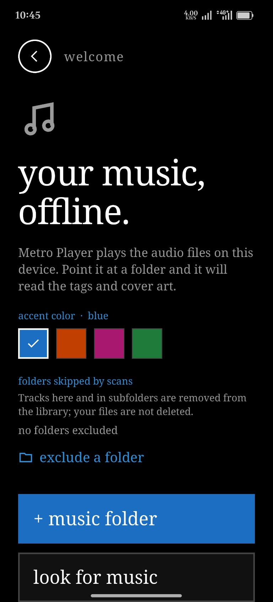
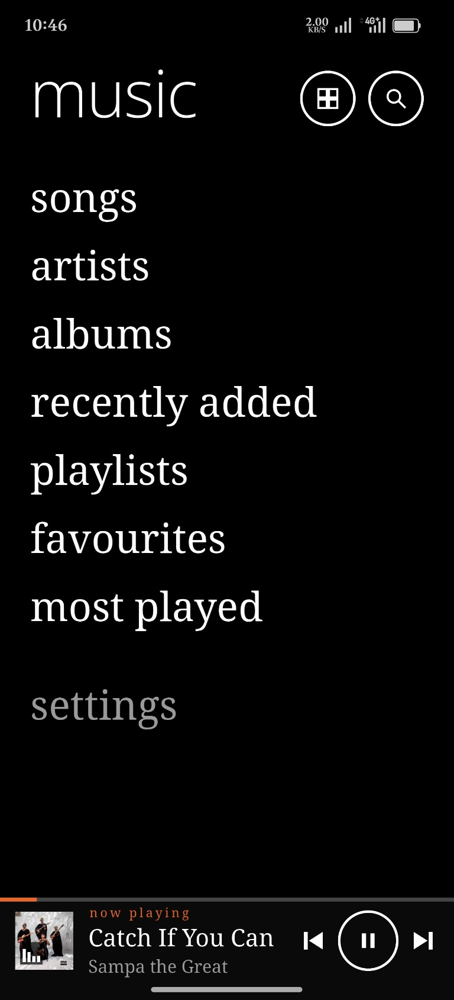
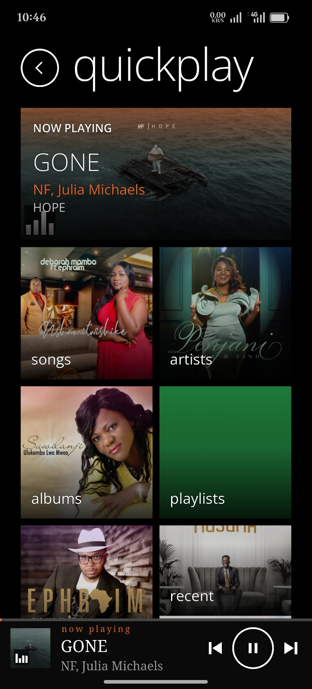
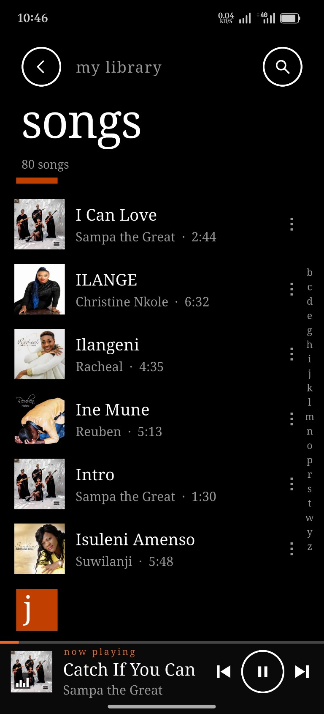
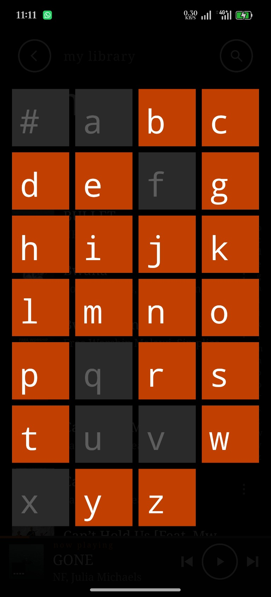
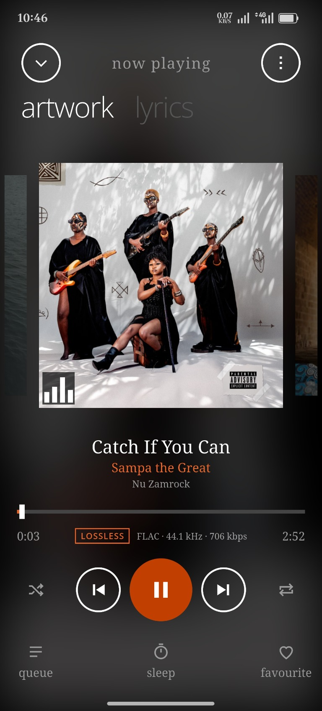
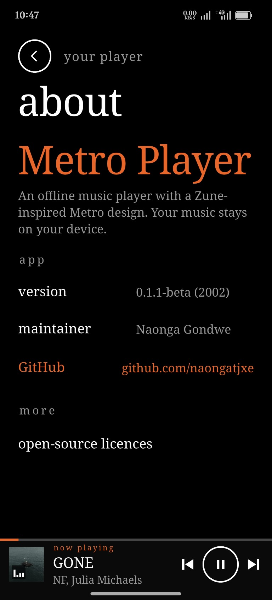

# Metro Player

Metro Player is an offline music player for Android, built around a Zune-inspired
Metro interface: oversized typography, bold accent color, and a wall of live
album-art tiles.

## Theme

- Dark, high-contrast surfaces with a configurable accent color.
- Large editorial-style headings and clean, compact song details.
- Live artwork tiles that rotate through music from the library and playlists.
- A focused Now Playing screen with artwork and lyrics, without swipe-based
  page navigation.

## Features

- Plays audio files stored on the device and keeps the library database local.
- Browse songs, albums, artists, playlists, recently played tracks, and history.
- Alphabetical letter groups and jump grid for songs, albums, artists, and recent additions.
- Shuffle builds a visible upcoming queue; played tracks are hidden from it.
- Quickplay live tiles and mixes built from listening and library details.
- Lyrics from local files or embedded tags, with an online LRCLIB lookup option.

## Screenshots

<p align="center">
  
  
  
</p>

<p align="center">
  
  
  
</p>

<p align="center">
  
</p>

## Install

Download the APK matching your Android CPU architecture from
[GitHub Releases](https://github.com/naongatjxe/Metroplayer/releases). Use the
universal APK if you are unsure which one to choose.

## Build from source

Requires Flutter and the Android SDK.

```powershell
flutter pub get
flutter test
flutter build apk --release
```

Build separate ARMv7, ARM64, and x86_64 APKs with:

```powershell
flutter build apk --release --split-per-abi
```

## Maintainer

Naonga Gondwe · [GitHub](https://github.com/naongatjxe)
